# Site DNA — System Architecture Document

## Phase 01: Project Foundation, Skills Integration & Gemini/CrewAI Setup

---

## 1. System Overview & Purpose

**Site DNA** is an AI-powered website intelligence and strategic auditing platform engineered by **ASAAS AI (أساس للذكاء الاصطناعي)**. The comprehensive platform accepts a target website URL and conducts end-to-end strategic auditing, including:

1. Website discovery and metadata harvesting.
2. Visual identity, typography, and design analysis.
3. User experience (UX) and user interface (UI) evaluation.
4. Content strategy and marketing positioning assessment.
5. Performance, Core Web Vitals, and SEO technical audits.
6. Competitor discovery and comparison.
7. Strategic opportunity identification.
8. Prioritized development and design recommendations.
9. Executive report generation with grounded evidence.

### Phase 01 Scope
Phase 01 establishes the foundational engineering platform:
- Package structure with Python 3.11 and `src` layout.
- Environment-based configuration with Pydantic Settings.
- Unified LLM integration layer for Google Gemini (`gemini-3.8-flash`) and CrewAI (`gemini/gemini-3.8-flash`).
- Direct Gemini diagnostic service isolating SDK connectivity from agent orchestration.
- Foundational verification agent and CrewAI Flow pipeline with typed Pydantic state.
- FastAPI backend serving health and readiness probes.
- Unified local CLI (`doctor` and `smoke` commands).
- Comprehensive automated test suite (offline unit/API tests and guarded live integration tests).

---

## 2. Mandatory Technology Stack

| Layer | Technology | Selection Rationale |
|---|---|---|
| **Runtime** | Python 3.11.18 | Stable, high-performance runtime required by CrewAI and FastAPI. |
| **Package Management** | `uv` (0.13.7) | High-speed dependency resolution, virtual environment isolation, reproducible lockfiles. |
| **AI Orchestration** | CrewAI (1.15.37) + CrewAI Flows | Structured agent roles, bounded tasks, and stateful event-driven flow pipelines. |
| **LLM Provider** | Google Gemini API via Google AI Studio | Native provider integration targeting `gemini-3.8-flash`. |
| **LLM SDK** | `google-genai` (1.65.0) | Official, modern Google Gen AI Python SDK for direct diagnostic verification. |
| **Backend API** | FastAPI (0.162.0) + Uvicorn | Async HTTP service, automatic OpenAPI documentation, Pydantic contract validation. |
| **Configuration** | `pydantic-settings` (2.16.2) | Type-safe environment variable parsing with secret masking (`SecretStr`). |
| **Testing** | `pytest` (9.2.0) | Comprehensive unit, API, and opt-in live integration testing. |
| **Code Quality** | `ruff` (0.17.4) | Lightning-fast static analysis, linting, and import formatting. |

---

## 3. Package Structure

The repository follows a strict `src/` layout:

```
site-dna/
├── pyproject.toml              # Build metadata, dependencies, ruff/pytest configurations
├── uv.lock                     # Deterministic dependency lockfile
├── .env.example                # Safe environment configuration template
├── .gitignore                  # Git exclusion rules (secrets, venv, caches)
├── .python-version             # Python 3.11 pin
├── README.md                   # Operational guide and onboarding documentation
├── docs/
│   ├── architecture.md         # This document
│   ├── skills-audit.md         # Audit and selection of ASAAS skills
│   ├── skills-manifest.json    # Machine-readable skills registry
│   └── phase-01-validation.md  # Verifiable completion report
├── src/
│   └── site_dna/
│       ├── __init__.py         # Package version and export
│       ├── cli.py              # Local CLI commands (doctor, smoke)
│       ├── api/
│       │   ├── __init__.py
│       │   ├── main.py         # FastAPI application, lifespan, middleware
│       │   └── routes/
│       │       ├── __init__.py
│       │       └── health.py   # Health (/health) and readiness (/ready) endpoints
│       ├── core/
│       │   ├── __init__.py
│       │   ├── config.py       # Pydantic Settings with SecretStr & precedence rules
│       │   ├── logging.py      # Structured logging with secret redaction filters
│       │   └── llm.py          # Unified LLM factory for CrewAI & Gemini
│       ├── agents/
│       │   ├── __init__.py
│       │   └── smoke_agent.py  # Site DNA Foundation Smoke Agent & Crew execution
│       ├── flows/
│       │   ├── __init__.py
│       │   └── foundation_flow.py # Stateful CrewAI Flow with Pydantic state
│       ├── schemas/
│       │   ├── __init__.py
│       │   └── health.py       # Pydantic schemas for health, readiness, and agent outputs
│       └── services/
│           ├── __init__.py
│           └── gemini_diagnostics.py # Direct Google GenAI SDK diagnostic service
└── tests/
    ├── conftest.py             # Shared fixtures and mock configurations
    ├── unit/
    │   ├── test_config.py      # Configuration, precedence, and secret masking tests
    │   ├── test_llm.py         # LLM factory and provider prefix formatting tests
    │   └── test_flow.py        # CrewAI Flow lifecycle and state transition tests
    ├── api/
    │   └── test_health.py      # Health, readiness, and OpenAPI schema tests
    └── integration/
        └── test_gemini_live.py # Opt-in live Gemini SDK and CrewAI execution tests
```

---

## 4. Configuration Architecture & Secret Containment

Configuration is encapsulated in `site_dna.core.config.Settings`:
- **Secret Protection:** Sensitive fields (such as `gemini_api_key`) use `pydantic.SecretStr`. In string representations (`__repr__`, `__str__`), keys are masked as `[configured]` or `[missing]`.
- **Precedence Rule:** If both `GEMINI_API_KEY` and `GOOGLE_API_KEY` exist in the environment, `GEMINI_API_KEY` takes precedence. `GOOGLE_API_KEY` serves only as a fallback.
- **Fail Closed:** The application starts safely without credentials for offline health and test routines. Any attempt to invoke live LLM operations without credentials fails immediately with an explicit `GeminiConfigurationError`.

### Retry Boundaries & Error Propagation Architecture
1. **Bounded Retry Budget:**
   - To prevent cascading retry storms between the application layer, CrewAI/LiteLLM, and the underlying HTTP client, retries are strictly bounded:
     - Maximum attempts: 3 (1 initial call + at most 2 retries).
     - Jittered exponential backoff: 2.0s initial, capped at 15.0s.
     - Hard overall deadline: 60.0s total wall-clock budget.
2. **Error Classification & Immediate Halting:**
   - **Non-retryable (Halt on attempt 1):** `AUTHENTICATION_ERROR` (401), `PERMISSION_DENIED` (403), `INVALID_REQUEST` (400), `MODEL_UNAVAILABLE` (404), and permanent `QUOTA_EXCEEDED` (429).
   - **Retryable:** `SERVICE_UNAVAILABLE` (503), `REQUEST_TIMEOUT` (504), and transient network errors.
3. **No Silent Swallows or Masked Success:**
   - Provider exceptions are classified into typed `DiagnosticStatus` categories and surfaced transparently. Failures are never converted into synthetic success payloads.

---

## 5. Architectural Separation: Deterministic Tools vs. LLM Agents

A foundational tenet of the ASAAS AI architecture is:
> **The LLM must never be treated as a substitute for crawling, browser measurements, or technical checks.**

In subsequent phases (02 through 12):
1. **Deterministic Tools First:** Network crawling, DOM extraction, Lighthouse performance profiling, SSL audits, and DNS checks are executed by deterministic code and dedicated tools (e.g., Playwright, httpx, DNS resolvers).
2. **LLM as Synthesizer:** AI agents receive strictly validated, structured evidence gathered by deterministic tools. The agents do not speculate on measurements; they reason over concrete facts, assess strategic trade-offs, and generate actionable recommendations.

```mermaid
flowchart LR
    A[Target Website URL] --> B[Deterministic Scrapers & Checkers]
    B -->|Verified Evidence & Telemetry| C[Data Normalization & Pydantic Validation]
    C -->|Grounded Evidence Payload| D[CrewAI Specialist Agents]
    D -->|Reasoning & Recommendations| E[CrewAI Flow Orchestrator]
    E -->|Structured Intelligence Report| F[Report Artifact & API Response]
```



---

## 6. CrewAI Agent & Flow Orchestration

### Agent Responsibilities
- Agents represent concrete product responsibilities with bounded scopes.
- In Phase 01, the **Site DNA Foundation Agent** (`AI System Verification Specialist`) is configured with:
  - `allow_delegation = False`
  - `memory = False`
  - Zero external tool dependencies
  - Minimal deterministic verification prompt returning a validated `SmokeAgentOutput` Pydantic model.

### Flow Architecture
The workflow orchestration uses `crewai.flow.Flow` with typed state (`FoundationFlowState`):
- **Step 1 (`@start`):** `initialize_workflow` generates a unique `run_id`, records start time, and initializes execution state.
- **Step 2 (`@listen`):** `execute_foundation_agent` executes the foundation crew, validates output against the Pydantic schema, captures execution metrics or exceptions, and marks the flow `completed` or `failed`.

---

## 7. Security Boundaries & Invariants

Site DNA adheres to the following security invariants:
1. **Untrusted Target Content:** Website content retrieved in future crawling phases is untrusted data. It will never be rendered as executable HTML or passed directly into system shell commands.
2. **SSRF & Network Boundary Protection:** Future crawling services will enforce strict URL validation:
   - Private IP ranges (`10.0.0.0/8`, `172.16.0.0/12`, `192.168.0.0/16`, `127.0.0.0/8`, `::1`) are blocked.
   - Cloud metadata IP endpoints (`169.254.169.254`) are strictly blocked.
   - Strict protocol restrictions (HTTP/HTTPS only).
3. **Local-First Default:** The development server binds strictly to `127.0.0.1`.
4. **No Public Billable Endpoints:** The public HTTP API exposes only non-billable health and configuration readiness probes. Live model execution is gated behind local CLI commands with explicit `--live` opt-in.
5. **No Secret Leakage:** Logging filters redact known API key formats and bearer tokens automatically.

---

## 8. Planned Extension Points (Phases 02–12)

| Phase | Planned Module | Core Responsibility |
|---|---|---|
| **Phase 02** | `src/site_dna/crawler/` | Discovery, sitemap parsing, robots.txt compliance, URL normalization. |
| **Phase 03** | `src/site_dna/extractors/` | DOM parsing, metadata extraction, OpenGraph, JSON-LD schema analysis. |
| **Phase 04** | `src/site_dna/design/` | Visual identity, color palette extraction, typography audit (Asaas brand metrics). |
| **Phase 05** | `src/site_dna/ux/` | Accessibility (WCAG 2.1), navigation layout, mobile responsiveness checks. |
| **Phase 06** | `src/site_dna/content/` | Content tone, copywriting clarity, value proposition analysis. |
| **Phase 07** | `src/site_dna/seo/` | Technical SEO, indexing rules, Core Web Vitals, Lighthouse telemetry. |
| **Phase 08** | `src/site_dna/competitors/` | Competitor discovery, positioning comparison matrix. |
| **Phase 09** | `src/site_dna/synthesis/` | Multi-agent SWOT analysis and strategic opportunity prioritization. |
| **Phase 10** | `src/site_dna/reporting/` | Multi-format reporting (JSON, Markdown, PDF executive summary). |
| **Phase 11** | `src/site_dna/persistence/` | Database persistence (SQLite/PostgreSQL) and audit history tracking. |
| **Phase 12** | `src/site_dna/ui/` | Arabic RTL Web UI utilizing `asaas-ui` and Thmanyah typography. |
