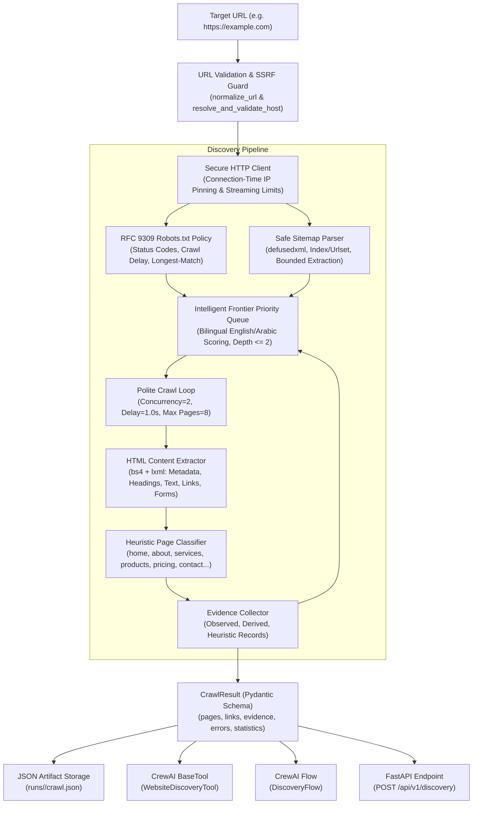

# Site DNA — Phase 02 Architecture Documentation
## Secure Website Discovery, Crawling & Structured Data Extraction Engine

**Organization:** ASAAS AI — أساس للذكاء الاصطناعي  
**Version:** 0.1.0 (Phase 02)  
**Status:** Completed & Validated  
**Date:** November 2026  

---

## 1. Subsystem Overview

Phase 02 provides Site DNA with a deterministic, SSRF-safe, bounded web crawling and evidence-collection subsystem. It transforms any publicly reachable target website URL into structured, auditable evidence (`CrawlResult`) without relying on LLM calls for crawler navigation.

---

## 2. Core Architectural Components

### 2.1 URL Validation & Preflight Security (`site_dna.discovery.url_validator`)
- Normalizes URLs, enforcing `http` or `https` schemes.
- Strips fragments and tracking query parameters (`utm_*`, `fbclid`, `gclid`).
- Rejects embedded user credentials (`user:pass@host`).
- Enforces strict port whitelisting (standard 80 and 443 only).

### 2.2 Connection-Time SSRF Defense (`site_dna.core.security` & `site_dna.discovery.http_client`)
- Prevents TOCTOU DNS rebinding by implementing a custom `httpcore.AsyncNetworkBackend` (`SSRFProtectedBackend`).
- Every TCP connect intercepts the target hostname, resolves all IP addresses, verifies they are globally routable, and connects directly to the validated IP.
- Maintains standard TLS SNI (`server_hostname`) and HTTP `Host` header to preserve certificate verification and virtual hosting.
- Enforces hard response streaming ceiling (`max_html_bytes = 3 MB`) and Content-Type validation.

### 2.3 RFC 9309 Robots.txt Policy (`site_dna.discovery.robots_policy`)
- Implements strict RFC 9309 compliance:
  - Longest-matching pattern specificity.
  - In equal-length matches, `Allow` takes precedence over `Disallow`.
  - Fail-open on 4xx responses (e.g. 404).
  - Fail-closed on 5xx responses or transport failures.
  - Extracts `Crawl-delay` and `Sitemap` directives.

### 2.4 Safe XML Sitemap Discovery (`site_dna.discovery.sitemap`)
- Uses `defusedxml.ElementTree` to prevent XXE (XML External Entity) attacks and XML entity expansion bombs.
- Recursively parses `<sitemapindex>` and `<urlset>` structures.
- Restricts extracted candidate URLs strictly to the target canonical origin.

### 2.5 Intelligent Frontier (`site_dna.discovery.frontier`)
- Min-heap priority queue scoring URLs from 0 to 100 based on strategic relevance:
  - Homepage: 100
  - Contact (EN: contact, AR: اتصل, تواصل): 90
  - About (EN: about, AR: من نحن, عن الشركة): 85
  - Services (EN: services, AR: خدماتنا): 80
  - Products (EN: products, AR: منتجات): 75
  - Pricing (EN: pricing, AR: أسعار, باقات): 70
- Restricts crawl depth to `max_depth = 2` and frontier tracking to `max_candidates = 200`.

### 2.6 HTML Content Extractor (`site_dna.discovery.extractor`)
- Uses BeautifulSoup with `lxml` parser.
- Extracts `PageMetadata` (title, description, canonical, language, charset, OpenGraph).
- Extracts heading hierarchy (H1, H2, H3).
- Extracts clean visible text excluding `<script>`, `<style>`, `<noscript>`, `<svg>`, `<nav>`, `<header>`, `<footer>`.
- Extracts navigation links, buttons/CTAs, image references with alt/dimensions, and form structures (without executing submissions).
- Parses schema.org `application/ld+json` blocks.

### 2.7 Heuristic Classifier (`site_dna.discovery.classifier`)
- Classifies pages into 11 categories (`home`, `about`, `services`, `products`, `pricing`, `contact`, `portfolio`, `blog`, `faq`, `other`, `unknown`).
- Weighted scoring combining URL paths (0.45), titles/H1 (0.35), and text snippets (0.20).

### 2.8 Traceable Evidence Generation (`site_dna.discovery.evidence`)
- Records granular `EvidenceRecord` items for every extracted data point, tracking `source_url`, `final_url`, `evidence_type` (`observed`, `derived`, `heuristic`), `field_reference`, `exact_value`, and `extraction_method`.

---

## 3. Integration Interfaces

| Interface | Module / Path | Description |
|---|---|---|
| **CLI** | `site-dna discover --url <URL> [--max-pages N] [--save]` | Direct command-line crawling and terminal report |
| **API** | `POST /api/v1/discovery` | Protected FastAPI endpoint with Bearer token authentication |
| **CrewAI Tool** | `site_dna.tools.WebsiteDiscoveryTool` | Standalone `BaseTool` ready for AI agent integration |
| **CrewAI Flow** | `site_dna.flows.DiscoveryFlow` | Orchestrated Flow with `DiscoveryFlowState` |
| **Storage** | `runs/<run_id>/crawl.json` | JSON artifact output directory |
