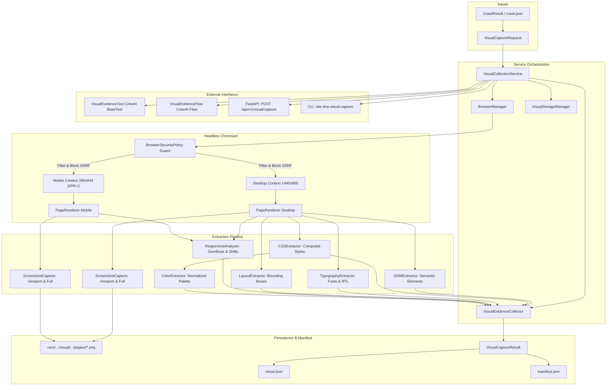

# Site DNA — Phase 03 System Architecture
## Browser Rendering, Visual DNA Extraction & Evidence Collection

**Organization:** ASAAS AI — أساس للذكاء الاصطناعي  
**Project:** Site DNA  
**Phase:** 03 — Visual & Evidence Collection  
**Status:** Completed & Validated  
**Target Environment:** Python 3.11, Playwright (Chromium), FastAPI, CrewAI Flows  

---

## 1. Executive Summary

Phase 03 introduces the **Visual Evidence & Rendering Engine** to Site DNA. While Phase 02 focused on deterministic, text-oriented crawling and structured data extraction, Phase 03 brings genuine visual perception. It takes previously discovered page URLs and executes high-fidelity rendering inside an isolated, headless Chromium browser instance.

The engine produces:
- Dual-viewport screenshots (Desktop 1440×900 and Mobile 390×844 with Device Pixel Ratio = 2.0 and touch simulation).
- Both viewport-clipped and full-page screenshots with dimensions verified via PIL and immutable SHA-256 checksums.
- Computed CSS and DOM structure records extracted through client-side script evaluation.
- Normalized color palettes with frequency counts and structural roles.
- Typography scales, font families, line heights, and directional metrics (supporting Arabic RTL).
- Spatial layout geometry and bounding boxes for key structural sections (`header`, `nav`, `hero`, `footer`).
- Responsive differential measurements (detecting mobile horizontal overflow and layout shifts).
- Traceable, auditable visual evidence records preserved in `runs/<crawl_run_id>/visual/<visual_run_id>/`.

---

## 2. High-Level Architecture Flowchart



---

## 3. Core Subsystems

### 3.1 Browser Manager (`site_dna.visual.browser_manager`)
Manages the lifecycle of headless Chromium instances via Playwright:
- **Sandbox Preservation:** Chromium's operating system sandboxing is strictly retained (no `--no-sandbox` flags are used).
- **Safe Launch Flags:** Configures process limits, disables background networking/sync, disables extension rendering, and enforces `--disable-dev-shm-usage`.
- **Profiles:**
  - `desktop`: 1440×900 viewport, DPR 1.0, desktop User-Agent.
  - `mobile`: 390×844 viewport, DPR 2.0, touch emulation enabled (`has_touch=True`, `is_mobile=True`), mobile Chrome User-Agent.
- **Context Isolation:** Each viewport runs in an isolated browser context, preventing cookie and state leakage.

### 3.2 Browser Egress Guard (`site_dna.visual.browser_security`)
Interprets and enforces network boundaries on every subresource and navigation request via Playwright's `context.route("**/*")`:
- **Prohibited Schemes:** Blocks `file:`, `ftp:`, `javascript:`, `chrome:`. Only `http`, `https`, `data:`, `blob:`, and `about:blank` are permitted.
- **WebSocket Blocking:** Aborts `websocket` and `eventsource` connection upgrades to prevent interactive channel hijacking.
- **SSRF Prevention:** Disallows loopback (`127.0.0.1`, `localhost`), cloud metadata (`169.254.169.254`, `metadata.google.internal`), and private IP ranges (`10.0.0.0/8`, `172.16.0.0/12`, `192.168.0.0/16`).
- **Test Exception:** Controlled `allow_test_loopback` flag scoped exclusively to specified test fixture origins.

### 3.3 Page Renderer (`site_dna.visual.renderer`)
Executes navigation milestones with bounded timeouts:
- Waits for `domcontentloaded` to prevent infinite hangs on slow streaming resources.
- Verifies `body` readiness with state `attached`.
- Enforces bounded font settling via `document.fonts.ready` (configurable timeout, default 2000ms).
- Dismisses browser dialogs (`alert`, `confirm`, `prompt`) automatically to avoid execution deadlocks.

### 3.4 Screenshot Subsystem (`site_dna.visual.screenshots`)
Captures authentic browser PNG renderings:
- Produces both viewport and full-page screenshots for each profile.
- Restricts full-page capture to a safe ceiling (`visual_max_page_height_px = 12000px`) to prevent memory exhaustion on infinite-scroll pages.
- Computes SHA-256 hashes directly from raw bytes.
- Inspects actual pixel dimensions using Pillow (`PIL.Image.open`).

### 3.5 DOM & CSS Extraction Subsystems
- **DOM Extractor (`site_dna.visual.dom_extractor`):** Inspects visible semantic nodes (`header`, `nav`, `main`, `section`, `h1-h6`, `button`, `footer`), generates structural DOM paths, extracts accessible names, and strictly excludes sensitive input fields and values.
- **CSS Extractor (`site_dna.visual.css_extractor`):** Evaluates `window.getComputedStyle` for target elements, capturing resolved colors, font attributes, displays, positions, and borders.
- **Color Extractor (`site_dna.visual.color_extractor`):** Normalizes `rgb()`, `rgba()`, and `#hex` colors into standard 6-character hex strings, clusters occurrences by usage context (`background`, `button_background`, `heading_text`, `text`, `border`), and ranks by frequency.
- **Typography Extractor (`site_dna.visual.typography_extractor`):** Extracts font stacks, font size (px), font weight, line height, text alignment, and text direction (`dir="rtl"` and `lang="ar"` support).
- **Layout Extractor (`site_dna.visual.layout_extractor`):** Captures bounding box coordinates (`x, y, width, height`), display modes, positions, and CSS grid/flex properties for core structural landmarks.
- **Responsive Analyzer (`site_dna.visual.responsive`):** Measures scroll dimensions against viewport bounds across viewports, detecting horizontal overflow warnings on mobile screens.

### 3.6 Storage Hierarchy (`site_dna.visual.storage`)
Persists all visual artifacts in an auditable directory tree:
```
runs/
└── <crawl_run_id>/
    ├── crawl.json
    └── visual/
        └── <visual_run_id>/
            ├── visual.json         # Complete structured Pydantic dump
            ├── manifest.json       # Audit manifest with checksums & page summaries
            └── pages/
                ├── page_00_<slug>_<hash>/
                │   ├── desktop-viewport.png
                │   ├── desktop-full.png
                │   ├── mobile-viewport.png
                │   └── mobile-full.png
                └── ...
```

---

## 4. Multi-Interface Integrations

1. **CrewAI BaseTool (`VisualEvidenceTool`):** Exposes `visual_evidence_tool` for agentic workflows, accepting `crawl_run_id` or `crawl_file` and executing synchronous visual collection.
2. **CrewAI Flow (`VisualEvidenceFlow`):** Coordinates stateful visual execution across steps (`initialize_visual_capture` -> `execute_visual_capture`) with comprehensive error logging and state management.
3. **FastAPI Route (`POST /api/v1/visual/capture`):** Exposes a protected HTTP endpoint guarded by configuration switches, local loopback checks, and optional Bearer token authentication.
4. **Command-Line Interface (`site-dna visual-capture`):** Provides a direct operational command to execute visual extraction on existing crawl artifacts with live progress logging and summary output.
