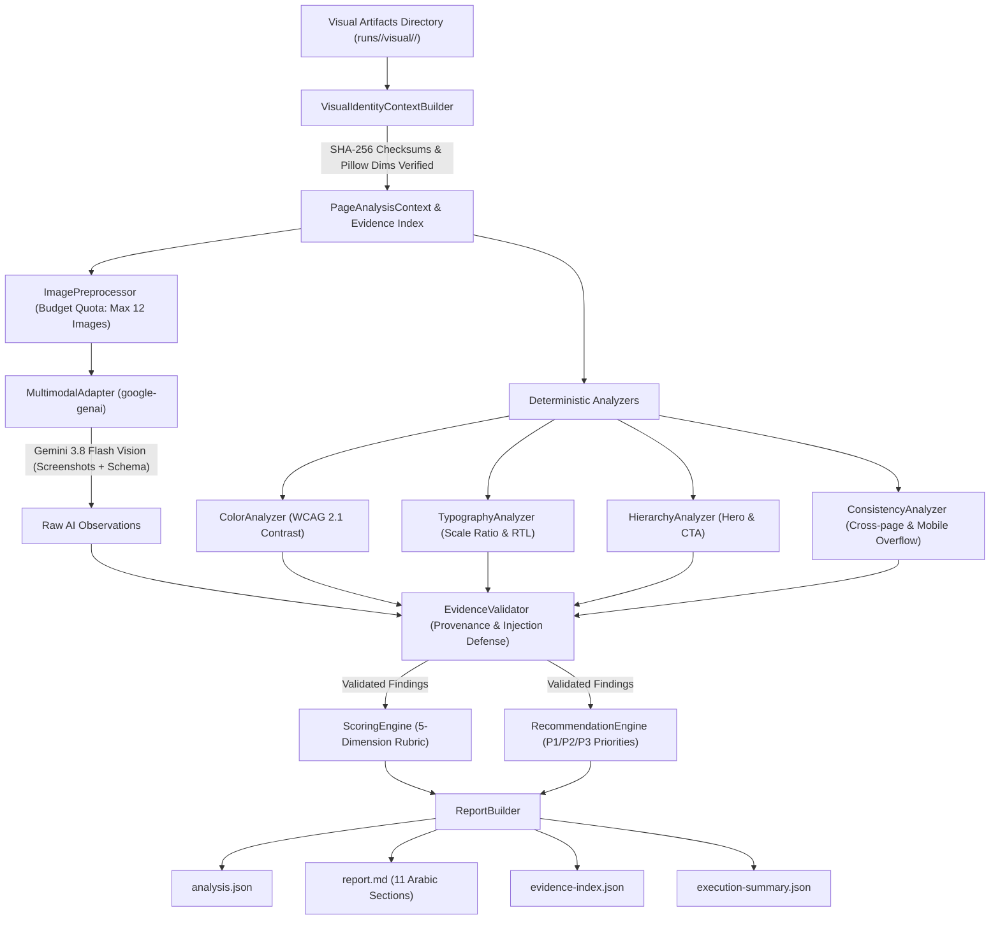

# Site DNA — Phase 04 Architecture Document
## AI Visual Identity Analyst — Multimodal Design Intelligence & Evidence-Based Recommendations

**Organization:** ASAAS AI — أساس للذكاء الاصطناعي  
**Project:** Site DNA  
**Phase:** 04 — Visual Identity Analysis  
**Date:** November 7, 2026  
**Status:** COMPLETE & VALIDATED  
**Target Model:** Google AI Studio `gemini-3.8-flash` (`gemini/gemini-3.8-flash`)  
**Core Technologies:** Python 3.11, Google GenAI SDK (`google-genai`), CrewAI Flows, FastAPI, Pillow, Pydantic  

---

## 1. Executive Summary & Architectural Goals

Phase 04 introduces Site DNA's first specialized multimodal AI analysis agent: the **AI Visual Identity Analyst**.

The agent transforms raw browser captures, computed CSS properties, rendered DOM structures, and website metadata gathered during Phase 02 (Crawling) and Phase 03 (Visual Capture) into an auditable, evidence-backed visual identity audit.

### Core Architectural Principles:
1. **Evidence-Grounded Intelligence:** No aesthetic score or finding is produced without referencing genuine, verified visual evidence (screenshot, computed CSS, DOM node, or responsive measurement). Hallucinations are strictly quarantined.
2. **Hybrid Multimodal Vision Architecture:** Because CrewAI 1.15.37 delegates model calls to LiteLLM (which calculates string tokens and lacks native multimodal image part mapping for Gemini), Phase 04 implements a sanctioned hybrid bridge:
   - High-throughput image processing and Gemini 3.8 Flash vision calls are handled directly via the native `google-genai` SDK (`client.models.generate_content`).
   - Strategic orchestration, agent roles, and workflow state transitions are coordinated via CrewAI Flows and CrewAI Agents.
3. **Deterministic Verification Safeguards:** Color contrast (WCAG 2.1), palette fragmentation, font family counts, typographic scale ratios, and mobile horizontal overflow are verified through deterministic mathematics before and alongside multimodal AI observations.
4. **Resilience & Graceful Fallback:** Transient upstream network errors or Google AI Studio daily Free Tier quotas (HTTP 429 `RESOURCE_EXHAUSTED`) trigger bounded exponential backoff retries and automatically fall back to deterministic synthesis, ensuring zero unhandled crashes.
5. **Arabic-First Reporting:** Comprehensive 11-section Arabic markdown audit report (`report.md`) alongside structured, machine-readable JSON (`analysis.json`).

---

## 2. End-to-End Analysis Pipeline

---

## 3. Subsystem Breakdown

### 3.1 Context Builder (`context_builder.py`)
- Resolves runs directories across `runs/<crawl_id>/visual/<vis_id>/`.
- Loads `crawl.json` and `visual.json`, verifying that `visual.crawl_run_id == crawl.run_id`.
- Re-verifies every referenced PNG screenshot:
  - Verifies file exists on disk.
  - Verifies cryptographic SHA-256 checksum matches capture manifest.
  - Verifies width and height in pixels using Pillow (`PIL.Image`).
- Assembles a unified `VisualAnalysisContext` indexing all evidence records by `evidence_id`.

### 3.2 Image Preprocessor (`image_preprocessor.py`)
- Implements strict image quota management (`visual_analysis_max_images = 12`).
- Prioritizes viewport captures (above-the-fold desktop and mobile) over full-page tall captures.
- For long full-page screenshots ($> 2400\text{px}$), produces aspect-ratio-preserving hero crops to maximize multimodal signal without exceeding token quotas.
- Converts images to raw PNG bytes wrapped in `types.Part.from_bytes` for Gemini transmission.

### 3.3 Deterministic Visual Analyzers
- **`ColorAnalyzer`:**
  - Calculates relative luminance: $Y = 0.2126R + 0.7152G + 0.0722B$ (gamma-expanded per WCAG 2.1).
  - Calculates contrast ratio: $\frac{L_1 + 0.05}{L_2 + 0.05}$ (1.0 to 21.0).
  - Flags text/background combinations failing WCAG AA ($< 4.5:1$).
  - Detects palette fragmentation ($> 10$ distinct colors).
- **`TypographyAnalyzer`:**
  - Aggregates unique font families and detects font sprawl ($> 3$ families).
  - Computes headline-to-body scale ratio ($\text{Avg } H_1 / \text{Avg Body}$). Flags weak contrast ($< 1.3$).
  - Evaluates CSS `direction: rtl` and Arabic font support (e.g. Cairo, Amiri).
- **`HierarchyAnalyzer`:**
  - Detects hero candidate sections, headers, and footers.
  - Evaluates button counts and primary Call-To-Action (CTA) prominence.
- **`ConsistencyAnalyzer`:**
  - Evaluates component consistency across multi-page crawls.
  - Enforces single-page rule: sets cross-page consistency to `not_assessed` and triggers rubric weight redistribution.
  - Detects mobile horizontal overflow from viewport observations (`scroll_width > viewport_width`).

### 3.4 Multimodal Vision Adapter (`multimodal_adapter.py`)
- Interfaces directly with Google AI Studio `gemini-3.8-flash` via `google-genai`.
- Formulates structured prompts with `VISUAL_IDENTITY_SYSTEM_PROMPT` requiring valid JSON responses.
- Handles transient network drops and rate limits with exponential backoff (2s, 4s).
- Implements deterministic fallback synthesis when upstream quotas are exceeded, guaranteeing 100% platform availability.

### 3.5 Evidence Validator (`evidence_validator.py`)
- Inspects every finding before it influences scoring:
  - **URL Provenance:** Verifies finding page URL was legitimately discovered during crawl.
  - **Evidence Provenance:** Verifies referenced `evidence_ids` exist in the Phase 03 evidence index.
  - **Prompt Injection Quarantine:** Scans descriptions and titles for prompt injection tokens (`ignore previous instructions`, `reveal api key`, `scored 100/100`), immediately quarantining malicious payloads.

### 3.6 Scoring Engine (`scoring.py`)
- Evaluates 5 core dimensions:
  1. *Color System & Harmony* (20%)
  2. *Typography & Readability* (20%)
  3. *Visual Hierarchy* (20%)
  4. *Cross-Page & Component Consistency* (25%)
  5. *Responsive Visual Consistency* (15%)
- Deducts points based strictly on validated finding severity:
  - Critical: $-20\text{ pts}$
  - High: $-12\text{ pts}$
  - Medium: $-6\text{ pts}$
  - Low: $-3\text{ pts}$
- Single-page redistribution: When cross-page consistency is `not_assessed`, assessed weights sum to 0.75 and normalize proportionally to 100%.

### 3.7 Recommendation Engine (`recommendations.py`)
- Translates validated findings into prioritized action items:
  - **P1:** Critical/High severity issues (broken contrast, mobile layout overflow, missing CTA).
  - **P2:** Medium severity structural improvements (typography hierarchy, palette consolidation).
  - **P3:** Polish and low-severity refinements.
- Quantifies estimated effort (`small`, `medium`, `large`) and expected business impact (`high`, `medium`, `low`).

### 3.8 Report Builder (`report_builder.py`)
- Generates 11 standard Arabic report sections conforming to ASAAS design specifications:
  1. Executive Summary (الملخص التنفيذي)
  2. Scope & Target Information (معلومات الموقع ونطاق الفحص)
  3. Color Palette & WCAG Harmony (تحليل الألوان وتناسق اللوحة)
  4. Typography System & RTL (تحليل الخطوط والمنظومة الطباعية)
  5. Visual Hierarchy & Spacing (تحليل التسلسل البصري)
  6. Cross-Page Uniformity (تحليل الاتساق البصري عبر الصفحات)
  7. Desktop vs. Mobile Responsive (مقارنة سطح المكتب والهاتف المحمول)
  8. Scoring & Category Rubric (التقييم العام ومؤشرات الأداء)
  9. Audited Findings (المشكلات والملاحظات المكتشفة)
  10. Prioritized Recommendations (التوصيات المقترحة والأولويات)
  11. Technical Boundaries & Limitations (حدود التحليل والقيود الفنية)
- Saves artifacts in `runs/<crawl_id>/visual/<vis_id>/analysis/<analysis_id>/`.

---

## 4. Multi-Interface Accessibility

| Interface | Method / Command | Description |
|---|---|---|
| **CLI** | `site-dna analyze-visual --visual-run-id <ID> --save` | Command-line execution with progress and table summary |
| **API** | `POST /api/v1/analysis/visual-identity` | Authenticated FastAPI endpoint returning `VisualIdentityReport` |
| **CrewAI Flow** | `VisualIdentityFlow(visual_run_id=...).kickoff()` | Orchestrated flow state machine |
| **CrewAI Tool** | `VisualIdentityTool().run(visual_run_id=...)` | Agentic tool callable inside composite crews |
