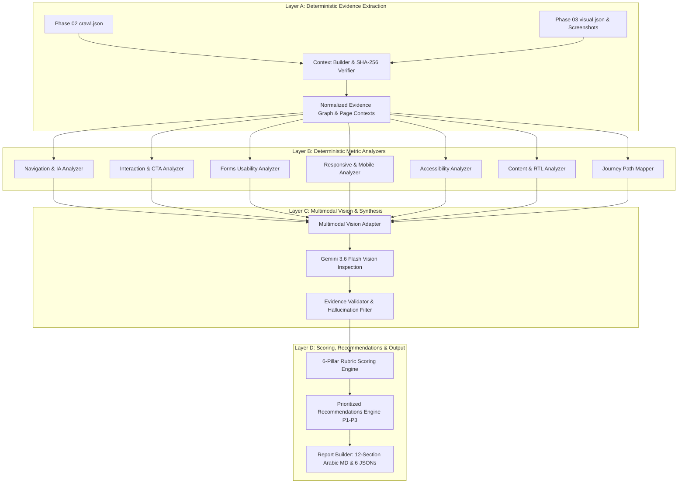

# Site DNA — Phase 05 Architecture: AI UX/UI & Usability Analyst

## 1. Overview and Mission

The **AI UX/UI Analyst** is Site DNA's specialized usability intelligence engine. It audits website user experience, navigation structures, interaction ergonomics, mobile touch targets, form usability, and basic accessibility standards (WCAG 2.1/2.2 AA).

Operating strictly on evidence captured in Phase 02 (Crawling) and Phase 03 (Visual Capture & DOM inspection), Phase 05 combines deterministic algorithmic measurements with the multimodal visual reasoning of **Google Gemini 3.6 Flash** (`gemini-3.6-flash`).

---

## 2. Multi-Layer Architecture

The analysis pipeline is structured into three distinct layers ensuring zero hallucinations and absolute evidentiary grounding:



### Layer A — Ground-Truth Evidence Intake
- **Context Builder (`UXContextBuilder`):** Resolves and loads `visual.json`, `manifest.json`, and `crawl.json`.
- **Integrity Verification:** Computes SHA-256 checksums of desktop and mobile screenshot PNG files against on-disk files, verifying image dimensions with Pillow.
- **Path Traversal Security:** Rejects malicious or relative run identifiers (`../`, `..\\`, absolute paths).

### Layer B — Deterministic Analysis Engines
Seven specialized modules extract concrete usability metrics:
1. **Navigation Analyzer:** Directed link graph, BFS reachability, orphan page detection, ambiguous anchor texts (`اضغط هنا`, `click here`), and duplicate destinations.
2. **Interaction Analyzer:** Primary CTA detection, button/link bounding box measurement, standalone click target threshold ($24\times 24$ px WCAG 2.2 Level AA min), and accessible label auditing.
3. **Forms Analyzer:** Zero-forms neutral handling, input label associations, placeholder-only fields, and submit button existence.
4. **Responsive Analyzer:** Horizontal viewport overflow detection, clipped elements, and mobile touch target threshold ($44\times 44$ px / $48\times 48$ px ergonomic target).
5. **Accessibility Analyzer:** Heading hierarchy sequencing (H1 $\rightarrow$ H2 $\rightarrow$ H3), missing `alt` on images, unlabeled icon buttons, and WCAG AA contrast notes.
6. **Content Usability Analyzer:** Arabic RTL (`dir="rtl"`, `lang="ar"`), paragraph word counts, scanability index, and heading distribution.
7. **Journey Mapper:** Maps 4 canonical website goals (Contact/Support, Services/Products, About Us, Pricing/Plans), step count, and friction points.

### Layer C — Multimodal Vision Intelligence
- **Model:** Exclusively **Gemini 3.6 Flash** (`gemini-3.6-flash`, CrewAI: `gemini/gemini-3.6-flash`).
- **Multimodal Adapter (`MultimodalUXAdapter`):** Inspects desktop and mobile viewport screenshots. Focuses on visual hierarchy, CTA affordance, visual noise, clutter, and layout stability.
- **Evidence Validator:** Strictly validates all AI-generated observations against Layer A ground-truth DOM and screenshot indices. Quarantines unverified URLs or hallucinated element references.

---

## 3. Component Hierarchy & File Layout

```
src/site_dna/
├── analysis/
│   └── ux_ui/
│       ├── __init__.py               # Public exports
│       ├── accessibility_analyzer.py # Heading skips, image alt, focusable roles
│       ├── content_usability.py      # Scanability, RTL direction, text density
│       ├── context_builder.py        # Run verification, artifact resolution, integrity checks
│       ├── evidence_validator.py     # Ground-truth cross-referencing and quarantine
│       ├── forms_analyzer.py         # Form input labels, placeholders, neutral mode
│       ├── interaction_analyzer.py   # Touch targets, button ergonomics, CTA clarity
│       ├── journey_analyzer.py       # User task flow routing & friction identification
│       ├── multimodal_adapter.py     # Gemini 3.6 Flash vision inspection & fail-soft
│       ├── navigation_analyzer.py    # Link graph BFS, orphan pages, ambiguous links
│       ├── recommendations.py        # P1-P3 actionable improvements engine
│       ├── report_builder.py         # 12-section Arabic report & artifact generation
│       ├── responsive_analyzer.py    # Mobile viewport overflow, clipped elements
│       ├── scoring.py                # 6-dimension weighted rubric calculator
│       └── service.py                # Main orchestration service (UXAnalysisService)
├── agents/
│   └── ux_ui_agent.py               # CrewAI Agent targeting gemini/gemini-3.6-flash
├── tools/
│   └── ux_ui_tool.py                # CrewAI BaseTool wrapper for UX analysis
├── flows/
│   └── ux_ui_flow.py                # CrewAI Flow with @start() and @listen()
├── api/
│   └── routes/
│       └── ux_ui.py                 # FastAPI endpoint POST /api/v1/analysis/ux-ui
└── schemas/
    └── ux_ui.py                     # Pydantic schemas for all UX/UI models
```

---

## 4. Execution Flow

1. **Intake:** Request received via CLI (`site-dna analyze-ux`), API (`POST /api/v1/analysis/ux-ui`), or CrewAI Flow (`UXUIFlow`).
2. **Context Assembly:** `UXContextBuilder` loads verified artifacts from `runs/<crawl_id>/visual/<vis_id>/`.
3. **Deterministic Scan:** Analyzers evaluate graph, forms, touch targets, hierarchy, and RTL.
4. **Multimodal Inference:** Viewport screenshots are provided to Gemini 3.6 Flash for visual UX audit (fail-soft if offline or quota exceeded).
5. **Evidence Cross-Checking:** Observations are checked against DOM records; non-verifiable claims are filtered.
6. **Scoring & Prioritization:** 6-dimension rubric calculates normalized 0–100 score; recommendations are assigned priorities (P1, P2, P3).
7. **Artifact Persistence:** 7 structured output files are generated in the run's `analysis/ux/<analysis_id>/` directory.
