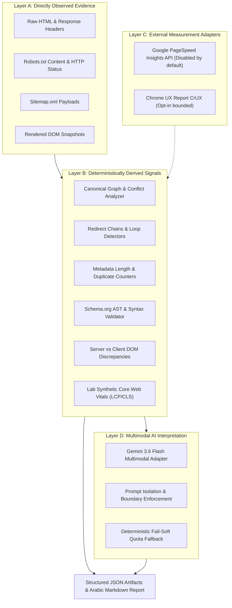

# Site DNA — Phase 07: Technical SEO & Website Performance Intelligence Architecture

**Organization:** ASAAS AI — أساس للذكاء الاصطناعي  
**System:** Site DNA  
**Phase:** 07 — Technical SEO & Website Performance  
**Status:** Validated Production Foundation  
**AI Model:** Gemini 3.6 Flash (`gemini-3.6-flash`, CrewAI: `gemini/gemini-3.6-flash`)

---

## 1. Subsystem Purpose & Mission

The Phase 07 Technical SEO and Website Performance subsystem provides an evidence-based, deterministic, and multimodal AI-augmented audit of a website's technical discoverability, crawlability, indexability, metadata health, structured data compliance, and rendering performance.

It bridges low-level network and DOM observations with actionable technical recommendations, strictly avoiding unsubstantiated assumptions (such as asserting Google index status without authoritative Search Console evidence).

---

## 2. Four-Layer Evidence Architecture

1. **Layer A (Directly Observed Evidence):**
   - HTTP status codes, raw headers, robots.txt directives, sitemap XML entries, raw `<title>`, `<meta>`, `<link>`, and rendered DOM elements from Playwright sessions.
2. **Layer B (Deterministically Derived Signals):**
   - Computed canonical graph relationships, detected redirect loops, duplicate title hashes across crawled pages, Schema.org missing required properties, and simulated browser render timings.
3. **Layer C (External Measurement Adapters):**
   - Strict boundaries: Disabled by default to avoid unexpected billing, API rate limits, or external dependencies. When enabled, responses are clearly marked with `field_vs_lab` labels and provenance timestamps.
4. **Layer D (Multimodal AI Interpretation):**
   - Gemini 3.6 Flash evaluates combined technical signals, synthesizes contextual priority findings, and outputs structured strategic remediation steps. If quota or service limits are reached, the system fails soft without dropping deterministic audits.

---

## 3. Core Component Pipeline

- **`TechnicalSEOContextBuilder` (`src/site_dna/analysis/technical_seo/context_builder.py`):**
  Loads, parses, and normalizes discovery crawl data (`crawl.json`) and visual capture results (`manifest.json`) into strongly-typed `TechnicalPageRecord` collections.
- **Specialized Analyzers:**
  - `RobotsAnalyzer`: Disallow/allow path pattern matching, user-agent rules, and sitemap directives.
  - `SitemapAnalyzer`: Structure, cross-domain safety, and crawled vs. uncrawled coverage.
  - `CanonicalAnalyzer`: Cross-page targets, broken destinations (4xx/5xx), and noindex target conflicts.
  - `RedirectAnalyzer`: HTTP -> HTTPS enforcement, redirect chains, and circular loop detection.
  - `MetadataAnalyzer`: Title existence, length boundaries (60-70 chars), description, viewport, and language tags.
  - `StructuredDataAnalyzer`: Safe JSON-LD AST parsing (no code evaluation), Schema type detection, and required field audit.
  - `JavaScriptSEOAnalyzer`: Discrepancy analysis between server-rendered raw HTML and client-rendered DOM.
  - `MobileSEOAnalyzer`: Viewport tag validation, horizontal overflow detection, and content parity.
  - `InternationalSEOAnalyzer`: HTML lang tags, hreflang links, reciprocal validation, and `x-default`.
  - `CoreWebVitalsAnalyzer`: Safe LCP/CLS lab approximation; strict refusal to fabricate unmeasured INP or CrUX data.
- **`EvidenceValidator` (`src/site_dna/analysis/technical_seo/evidence_validator.py`):**
  Matches findings against raw evidence IDs; quarantines any hallucinated or unverified observations.
- **`TechnicalSEOMultimodalAdapter` (`src/site_dna/analysis/technical_seo/multimodal_adapter.py`):**
  Prepares prompt payloads for Gemini 3.6 Flash (`gemini-3.6-flash`), managing token quotas and graceful fallback.
- **`TechnicalSEOReportBuilder` (`src/site_dna/analysis/technical_seo/report_builder.py`):**
  Compiles the complete 14-artifact suite including `analysis.json` and Arabic `report.md`.

---

## 4. API & Integration Surface

- **FastAPI Endpoint:** `POST /api/v1/analysis/technical-seo`
  - Validates `crawl_run_id` and `visual_run_id` with regex protection against path traversal.
  - Returns `TechnicalSEOReport` in JSON with full HTTP 200/400/404 handling.
- **CrewAI Agent & Tool:**
  - Agent: `Technical SEO & Performance Analyst` configured with `gemini/gemini-3.6-flash`.
  - Tool: `TechnicalSEOTool` inheriting from `crewai.tools.BaseTool`.
- **CLI Subcommand:** `site-dna analyze-seo --crawl-run-id <ID> [--visual-run-id <ID>] [--deterministic-only] [--save]`
  - Emits formatted Arabic summaries, metric breakdowns, and exit codes (0 for success, 3 for AI quota fail-soft).
