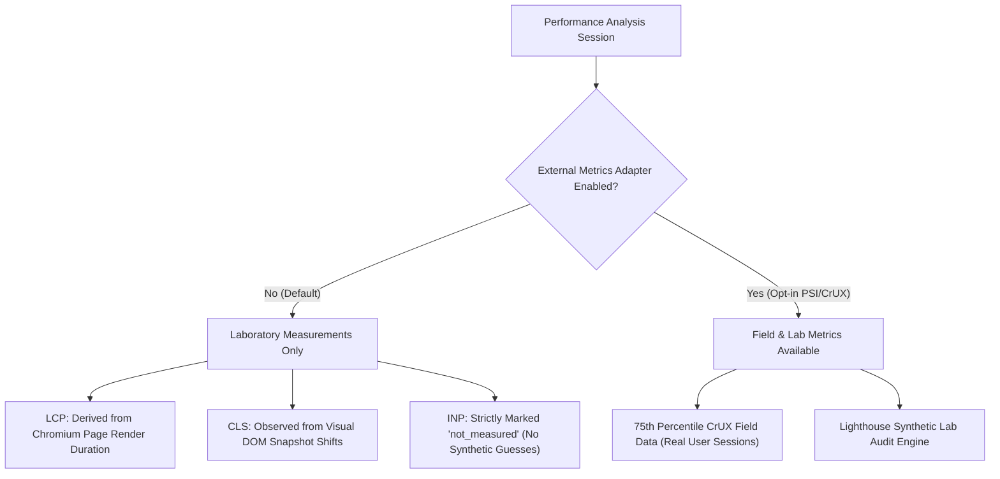

# Site DNA — Phase 07: Website Performance & Core Web Vitals Intelligence

**Organization:** ASAAS AI — أساس للذكاء الاصطناعي  
**System:** Site DNA  
**Phase:** 07 — Technical SEO & Website Performance Intelligence

---

## 1. Performance Measurement Philosophy

Site DNA adheres to strict scientific and engineering rigor regarding web performance measurement:
1. **Never fabricate field data:** Real user experience data (such as Google Chrome UX Report / CrUX) requires real user visits across diverse network and device conditions. In the absence of an authenticated CrUX connection or sufficient traffic, Site DNA explicitly marks field metrics as `not_assessed` or `not_measured`.
2. **Explicit Lab vs. Field Labeling:** Every recorded metric explicitly declares its provenance (`lab_browser`, `crux_field`, `psi_api`, or `not_measured`).
3. **The INP Interaction Rule:** Interaction to Next Paint (INP) requires interactive DOM events (clicks, keypresses, taps). A synthetic headless render without scripted interaction cannot accurately report INP; therefore, INP is strictly set to `inp_source="not_measured"` with `inp_ms=None` unless real interactive test suites are executed.

---

## 2. Core Web Vitals Reference & Thresholds

| Metric | Full Name | Lab Approximation Source | Good Threshold | Needs Improvement | Poor Threshold |
|---|---|---|---|---|---|
| **LCP** | Largest Contentful Paint | Browser viewport render completion duration | $\le 2500\text{ ms}$ | $2500\text{ ms} - 4000\text{ ms}$ | $> 4000\text{ ms}$ |
| **CLS** | Cumulative Layout Shift | Layout shift records during Playwright render | $\le 0.10$ | $0.10 - 0.25$ | $> 0.25$ |
| **INP** | Interaction to Next Paint | Synthetic interaction test session only | $\le 200\text{ ms}$ | $200\text{ ms} - 500\text{ ms}$ | $> 500\text{ ms}$ |

---

## 3. Laboratory vs. Field Attribution

### Lab Metrics Caveats
- Laboratory measurements reflect isolated network conditions and execution on local host hardware.
- Local Chromium load times depend on memory, CPU scheduling, and local proxy configuration.
- To prevent skewed audits, Site DNA averages duration across pages and flags local measurement limitations in `notes`.

---

## 4. Remediation Guidance for Poor Performance
When LCP exceeds 2500 ms or CLS exceeds 0.10, the engine generates prioritized (P1/P2) recommendations:
- **Server Response Time (TTFB):** Optimize backend queries, caching layers, and reverse proxy compression.
- **Render-Blocking Resources:** Defer non-critical CSS/JS, utilize modern HTTP/2 or HTTP/3 multiplexing.
- **Image Optimization:** Modern image formats (AVIF, WebP), explicit width/height dimensions to eliminate layout shifts (CLS), and responsive `srcset`.
