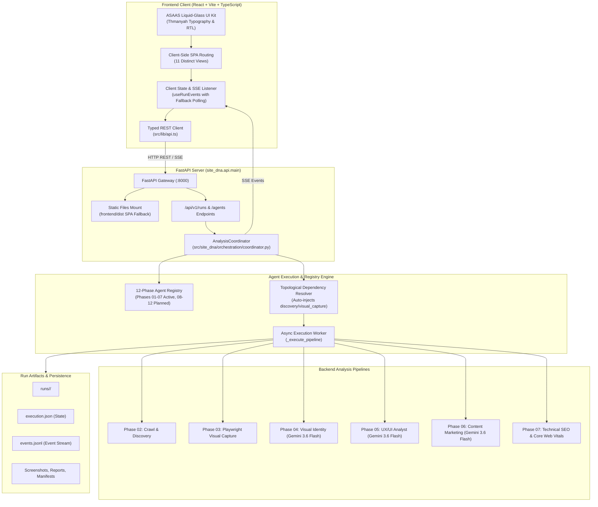

# Site DNA — Phase 07.5: Frontend Platform Architecture & Agent Dashboard

## 1. Executive Summary

Phase 07.5 delivers a unified, production-grade web application frontend for **Site DNA (بصمة الموقع)**. Built with React 19, TypeScript, Vite, and the official **ASAAS UI Kit**, this platform transforms the headless Python backend and CrewAI agent pipelines into an interactive, bilingual (Arabic RTL primary / English LTR secondary) operations dashboard.

Crucially, Phase 07.5 provides **interactive, selective agent orchestration**: users choose exactly which analysis agents to execute on a target URL rather than running the entire heavy suite blindly, while maintaining full visibility and boundary enforcement for upcoming Phase 08–12 intelligence agents.

---

## 2. System Architecture

---

## 3. Key Architectural Decisions

### 3.1 Dual Deployment Model (Unified Serving)
- **Development Mode**: Vite dev server (`http://localhost:5173`) proxies `/api` calls to FastAPI at `http://127.0.0.1:8000`.
- **Production Mode**: Vite builds optimized single-page static bundles to `frontend/dist`. FastAPI natively mounts `frontend/dist` and serves both the REST API and the SPA with index HTML fallback for any non-API client routes.

### 3.2 Selective Agent Orchestration
Rather than imposing an all-or-nothing execution model, the system allows the user to check or uncheck individual analysis stages:
- **Discovery (Phase 02)**: Fundamental baseline crawler.
- **Visual Capture (Phase 03)**: Headless Playwright screenshot and DOM/CSS extractor.
- **Visual Identity (Phase 04)**: Multimodal design audit powered by `gemini-3.6-flash`.
- **UX/UI Analyst (Phase 05)**: Usability, CTA, navigation, and mobile ergonomics audit.
- **Content & Marketing (Phase 06)**: Messaging, value proposition, and conversion copy audit.
- **Technical SEO (Phase 07)**: Crawlability, indexability, canonicals, and Core Web Vitals.
- **Automatic Dependency Resolution**: Selecting `visual_identity` or `ux_ui` automatically queues `visual_capture` and `discovery`.

### 3.3 Strict Phase 08–12 Planned Agent Boundaries
- Agents for Phases 08–12 (*Competitor Intelligence*, *Market Positioning*, *CRO*, *Security & Compliance*, *Executive Synthesis*) are registered with `implementation_status: "planned"` and `can_execute: False`.
- In the frontend, their selector cards are visually locked with a "قريبًا" badge and disabled checkboxes.
- If a client bypasses the frontend and attempts to invoke a planned agent via `POST /api/v1/runs`, the backend immediately rejects the submission with `HTTP 400 Bad Request`.

### 3.4 Resilient Real-Time Event Architecture
- Real-time updates utilize Server-Sent Events (SSE) via `/api/v1/runs/{run_id}/events`.
- The frontend hook `useRunEvents` manages connection lifecycle, parsing structured `RunEvent` objects (`stage.started`, `stage.progress`, `stage.completed`, `run.completed`).
- Automatic fallback: If SSE fails to connect or disconnects unexpectedly, the client gracefully degrades to polling `/api/v1/runs/{run_id}` every 2 seconds without interrupting user experience.
