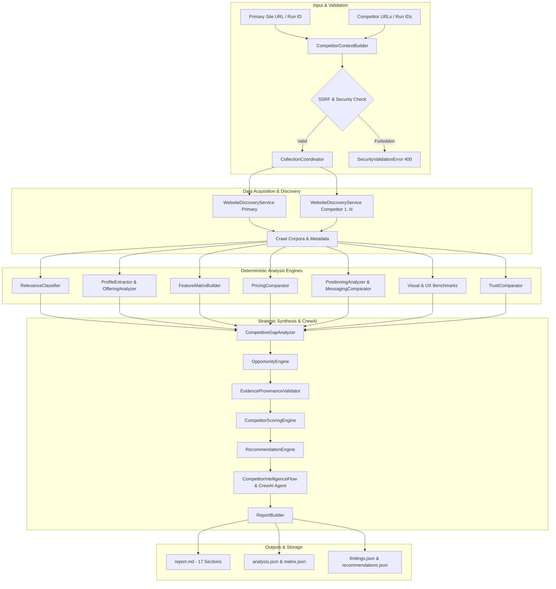

# Site DNA — Phase 08 Architecture: Competitor Intelligence & Benchmarking

**Organization:** ASAAS AI — أساس للذكاء الاصطناعي  
**Product:** Site DNA — بصمة الموقع  
**Phase:** 08 — Competitor Intelligence & Strategic Opportunity Analysis  
**Framework:** CrewAI + FastAPI + React TypeScript  
**Official AI Model:** `gemini-3.6-flash` (`gemini/gemini-3.6-flash`)

---

## 1. Executive Summary

Phase 08 introduces the **Site DNA Competitor Intelligence Engine**, enabling comparative benchmarking between a primary target website and 1–3 competitors (Mode A: up to 5 sites total). The architecture synthesizes evidence across multi-site crawl corpora, evaluating offerings, feature parity, pricing models, positioning, UX/visual patterns, and trust signals to surface actionable P1–P3 strategic recommendations.

---

## 2. System Architecture Diagram

---

## 3. Core Modules

1. **`context_builder.py`**: Normalizes input URLs, resolves primary run dependencies, executes strict SSRF/private IP blocking via `validate_url_security`, and creates immutable `CompetitorAnalysisContext`.
2. **`collection_coordinator.py`**: Coordinates multi-site crawling with site-specific depth/page budgets (default 5 pages/site).
3. **`relevance.py`**: Classifies competitor relevance into `direct`, `indirect`, `adjacent`, or `not_comparable`.
4. **`company_profiles.py` & `offering_analyzer.py`**: Normalizes product catalogs and company profiles.
5. **`feature_comparison.py`**: Generates multi-site feature comparison matrix with explicit provenance statuses:
   - `observed_present`
   - `observed_absent_in_inspected_scope`
   - `claimed`
   - `not_found_in_sample`
   - `not_assessed`
   - `not_comparable`
6. **`pricing_comparison.py`**: Detects public pricing tiers with safeguards against misleading comparisons.
7. **`positioning_analyzer.py` & `messaging_comparison.py`**: Compares value propositions, tones, and messaging frameworks.
8. **`benchmarks.py`**: Cross-site comparison of design tokens, layout patterns, and technical metrics.
9. **`trust_signals.py`**: Evaluates credentials, certifications, reviews, and client logos.
10. **`gap_analyzer.py` & `opportunities.py`**: Formulates competitive gaps and strategic opportunities.
11. **`evidence_validator.py`**: Anti-hallucination verification ensuring every claim links to inspected DOM or text.
12. **`scoring.py`**: 6-dimension benchmark score calculation with guardrails for exploratory sites.
13. **`recommendations.py`**: Formulates prioritized P1, P2, P3 recommendations with validation criteria.
14. **`report_builder.py`**: Generates a 17-section Arabic Markdown audit report (`report.md`).
15. **`service.py`**: Master orchestrator implementing `analyze_competitors`.

---

## 4. LLM Integration & CrewAI

- **Model Specification**: Strictly Google AI Studio `gemini-3.6-flash`.
- **CrewAI Identifier**: `gemini/gemini-3.6-flash`.
- **System Prompt Integrity**: Rooted in grounded evidence; strictly prohibits fabricating features, pricing tiers, or unobserved metrics.
