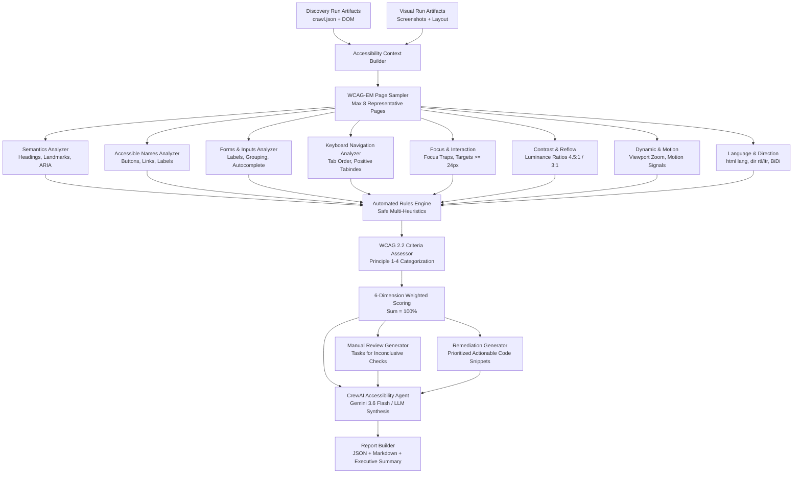

# Site DNA — Phase 10: Architecture & Technical Specification
## AI-Powered Web Accessibility, Inclusive Experience & WCAG 2.2 Intelligence

**Organization:** ASAAS AI — أساس للذكاء الاصطناعي  
**Engine:** Site DNA Accessibility Engine  
**Standard:** W3C Web Content Accessibility Guidelines (WCAG) 2.2, Levels A and AA  
**Evaluation Standard:** WCAG-EM 2.0 (Website Accessibility Conformance Evaluation Methodology)  
**AI Framework:** CrewAI Flows (`gemini/gemini-3.6-flash`)  
**Backend:** Python 3.11 + FastAPI  
**Analysis Posture:** Non-destructive, evidence-grounded, passive audit  

---

## 1. Architectural Overview

The Phase 10 engine introduces an enterprise-grade, deterministic-first, AI-augmented accessibility assessment layer into Site DNA. It ingests prior discovery crawl artifacts (`crawl.json`), browser visual state snapshots, and UX DOM trees to perform comprehensive WCAG 2.2 evaluation without triggering destructive mutations or violating third-party form constraints.

---

## 2. Weighted Scoring Formula

In accordance with WCAG-EM 2.0 and inclusive UX design principles, the overall composite score (0–100) is calculated from 6 orthogonal weighted dimensions:

1. **Perceivable Semantics & Structure (20%):**
   - Heading hierarchical order (no skipping `h1` to `h3`), single primary `h1` per page.
   - HTML5 structural landmarks (`<header>`, `<nav>`, `<main>`, `<footer>`, `<aside>`).
   - Appropriate ARIA roles and validation against WAI-ARIA 1.2 specifications.

2. **Keyboard Operability & Focus Management (20%):**
   - Tab sequence predictability.
   - Zero usage of harmful positive `tabindex > 0`.
   - Focus indicator visibility cues and escape routes for interactive modals.

3. **Color Contrast & Visual Accessibility (20%):**
   - Text to background luminance ratio: minimum 4.5:1 for standard text, 3:1 for large text (WCAG 1.4.3).
   - Non-text interface components & focus indicators contrast: minimum 3:1 (WCAG 1.4.11).
   - Viewport scalability preservation (`user-scalable=no` or `maximum-scale < 2` detected as violation).

4. **Forms, Inputs & Error Prevention (15%):**
   - 100% of input elements associated with explicit `<label for="...">` or `aria-label`/`aria-labelledby`.
   - Grouping for radio buttons and checkboxes via `<fieldset>` and `<legend>`.
   - Appropriate `autocomplete` attribute usage on common identity/payment fields.

5. **Navigation & Wayfinding (15%):**
   - Skip-to-content links (`<a href="#main">`).
   - Informative and descriptive link text (flagging "click here", "اضغط هنا", "more", "قراءة المزيد").
   - Unique and descriptive page `<title>` elements.

6. **Language, Media & RTL Inclusivity (10%):**
   - Explicit `lang` and `dir` attributes on `<html>` (`lang="ar" dir="rtl"`).
   - Proper directional isolation for mixed Arabic/English bidirectional text.
   - Text alternatives for non-decorative images (`alt` attribute audit).

---

## 3. Strict Deterministic + AI Hybrid Engine

- **Deterministic Layer:** 100% testable, transparent, reproducibly calculated directly from raw DOM and CSS color data. Never produces hallucinations or fabricated accessibility failures.
- **AI Agent Layer (Gemini 3.6 Flash):** Ingests deterministic findings, provides contextual explanations in Arabic and English, synthesizes executive summaries, and proposes tailored code remediation snippets.
