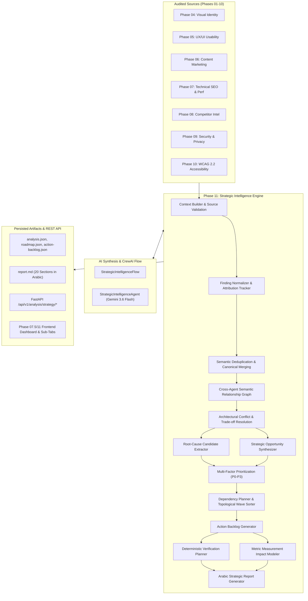

# Site DNA — Phase 11 Architecture Specification
## AI-Powered Strategic Intelligence, Cross-Agent Synthesis & Unified Action Roadmap

**Organization:** ASAAS AI — أساس للذكاء الاصطناعي  
**Product:** Site DNA — بصمة الموقع  
**Phase:** 11 — Strategic Intelligence & Unified Action Roadmap  
**Official AI Model:** Gemini 3.6 Flash (`gemini-3.6-flash`, CrewAI: `gemini/gemini-3.6-flash`)  
**Backend:** Python 3.11 + FastAPI  
**Orchestration:** CrewAI Flows (`StrategicIntelligenceFlow`)  
**Agent Implementation:** `StrategicIntelligenceAgent`  

---

## 1. System Overview

Phase 11 acts as the central strategic reasoning brain for Site DNA. While Phases 01 through 10 execute specialized audits across discovery, visual identity, UX/UI, copy & positioning, technical SEO, competitor benchmarking, security & privacy, and WCAG 2.2 accessibility, Phase 11 ingests these disparate findings and synthesizes them into an evidence-grounded, prioritized, and sequenced 4-wave roadmap.

---

## 2. Component Pipeline Architecture

1. **Context Builder (`context_builder.py`):**
   - Validates existence of upstream run directories (`runs/<crawl_run_id>/analysis/*`).
   - Parses analysis artifacts without modifying source data.
   - Computes source agent coverage metrics.
2. **Finding Normalizer (`finding_normalizer.py`):**
   - Normalizes heterogenous findings into a standard `NormalizedFinding` model.
   - Maps severity scales, assigns canonical domains, and captures original evidence points.
3. **Deduplication Engine (`deduplication.py`):**
   - Detects semantic overlaps across agents (e.g. contrast flagged by both Visual Identity and Accessibility).
   - Generates unified canonical findings while attributing all source findings and rationale.
4. **Relationship Graph (`relationship_graph.py`):**
   - Maps directed edges between findings: `enables`, `blocks`, `aggravates`, `mitigates`, `synergizes`.
5. **Conflict & Tradeoff Detector (`conflict_detection.py`):**
   - Identifies architectural conflicts (e.g., Security CSP vs Marketing Trackers, Brand Aesthetic vs High Contrast).
   - Formulates balanced remediations that strictly protect security and WCAG Level A compliance.
6. **Prioritization & Dependency Planner (`prioritization.py`, `dependency_planner.py`):**
   - Evaluates multi-factor scoring (impact, severity, effort, reversibility).
   - Sequences actions into 4 operational waves:
     - **Wave 1:** Immediate Critical Fixes (0–2 weeks, P0)
     - **Wave 2:** Structural & Compliance Alignment (2–6 weeks, P1)
     - **Wave 3:** Performance & SEO Synergy (6–12 weeks, P2)
     - **Wave 4:** Continuous Strategic Evolution (12+ weeks, P3)
7. **Verification & Metric Planner (`verification_planner.py`, `measurement_plan.py`):**
   - Generates deterministic verification criteria for every action.
   - Establishes baseline metrics and target goals without speculative financial ROI claims.
